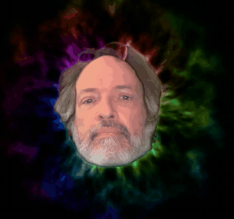

# obs-lsd

obs-lsd cuts your head out of your webcam feed at the neck, floats it on a
black background inside an animated psychedelic halo, and publishes that as
a virtual camera for Zoom or OBS.



macOS on Apple Silicon (Intel untested), Python 3.12. Runs on the CPU,
around 40ms a frame on an M5 Max, most of it MediaPipe's segmenter:

```
$ obs-lsd --input tests/data/portrait.jpg --seconds 3 --no-vcam --no-preview --stats
segment=27.0ms warp=0.3ms halo=8.6ms compose=4.6ms total=40.5ms
```

## Install

```sh
git clone https://github.com/dannyob/obs-lsd.git
cd obs-lsd
make install-dev models
```

That makes a `.venv` with [uv](https://docs.astral.sh/uv/), installs the
package into it, and downloads two MediaPipe models (about 20MB).

The virtual camera device itself comes from OBS. Install
[OBS Studio](https://obsproject.com/), launch it once, and click Start
Virtual Camera so macOS registers the system extension. After that you can
quit OBS for good; obs-lsd only needs the device it left behind.

## Quickstart

```sh
make run
```

A preview window opens, macOS asks for camera access, and "OBS Virtual
Camera" appears in Zoom's camera list. Pick it. obs-lsd reads the first
camera macOS lists; `--camera` picks another. With the preview window focused:

| key | does |
|-----|------|
| `q` or Esc | quit |
| `]` / `[` | grow / shrink the head |
| `.` / `,` | longer / shorter rays |
| `=` / `-` | faster / slower hue cycle |
| `s` | freeze the head cutout (the halo keeps moving) |
| `p` | print the current head size and halo settings to stderr |

The preview window is only there for the keys; `--no-preview` drops it and
the virtual camera carries on.

If Zoom shows the camera but only black, OBS is still running. Only one
program can feed the virtual camera, and OBS wins with its own, usually
empty, scene. Quit OBS, restart obs-lsd, re-select the camera in Zoom.

When the segmenter loses your face (you turn away, walk off, the light
goes), the last cutout is held, fades to black over a second, and comes
back when you do. The cutout is hair plus face skin, so a hat is not part
of it, and it tracks one face at a time.

No camera handy? `make smoke` runs the whole pipeline on a still portrait
and writes `/tmp/obs-lsd-smoke.png`.

## Options

`obs-lsd --help` lists everything. The ones you are likely to want:

- `--camera 1` or `--camera "Studio"` picks a camera by index or name
  substring; `--list-cameras` shows what is connected.
- `--input clip.mov` reads a video or still instead of a camera. With
  `--output out.mp4 --no-vcam --no-preview` it renders as fast as it can,
  timing the halo by the file's timestamps, so the same clip gives the
  same video every time.
- `--head-frac 0.55` sets how tall the head is as a fraction of the frame,
  and `--float 0.03` how far it drifts about the centre (0 to pin it).
- `--halo-reach`, `--halo-density`, `--halo-speed`, `--halo-rotate`,
  `--halo-flicker`, `--halo-hue-speed`, `--halo-spill`, `--halo-scale` tune
  the halo. Defaults and what each one does are on `HaloParams` in
  `src/obs_lsd/halo.py`.
- `--width`, `--height`, `--fps` set the output format (default 1280x720
  at 30). `--seconds N` stops after N seconds; `--dump-frame x.png` saves
  the last frame on exit.

## Evaluation rig

A second command, `obs-lsd-rig`, answers "does the halo look better after
that change?" It replays a short clip of your face through the pipeline
and has a vision model (via OpenRouter, billed to your key) score the
result against the rubric in `loop.md`: three criteria, 30 points each,
90 total. It can also run an evolutionary loop in which Claude Code
agents each try one halo tweak on a throwaway branch and the
highest-scoring survive. Record 20-30 seconds of yourself with QuickTime
into `clips/`, run `pass insert openrouter/api-key`, then:

```sh
make baseline CLIP=clips/me-01.mov   # score main
make eval CLIP=clips/me-01.mov       # score whatever is checked out
make evolve CLIP=clips/me-01.mov GENS=3
```

The loop costs money on both the judge and the agents, runs the agents
with permission prompts off in worktrees that share this repo's `.git`,
and pastes model-written notes into the next agent's prompt unfiltered.
The driver never checks out `main`, and nothing lands there except a
merge you type. It is a local single-user tool; don't point it at a clip
or branch you don't trust. Costs, gates, the ledger, and `calibrate`
(checking the judge against your own eye) are in [docs/rig.md](docs/rig.md).

## Development

```sh
make test     # pytest
make lint     # ruff
make smoke    # end-to-end on the still portrait
```

Tests are written first here; `make smoke` is the bar before a change
counts as working. MediaPipe must stay below 1.0 on macOS; the 1.x
releases crash. The design notes and implementation plans that produced
the code are in `docs/superpowers/`.

## License

MIT.
